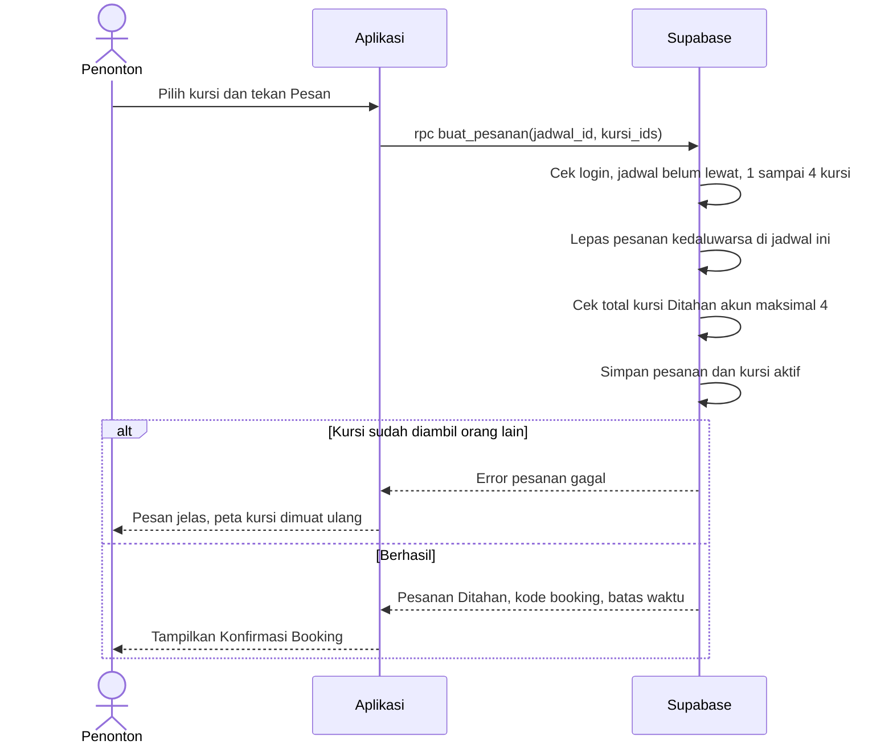
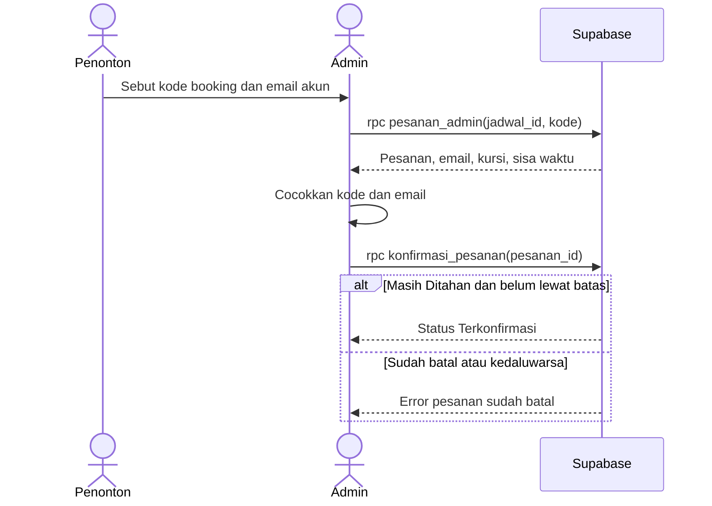

# SceneKita: Plan Pembangunan

| | |
|---|---|
| **Versi** | 1.0 |
| **Tanggal** | 20 November 2026 |
| **Tujuan** | Memandu urutan kerja, alur sistem, dan pemetaan layar ke data |
| **Dokumen terkait** | `BRD.md`, `SceneKita_Brief_MVP_v1.md`, `design_system_scenekita.md`, `scenekita_schema.sql`, `DATABASE-SUPABASE.md`, `GUARDRAILS.md`, `copilot-instructions.md` |

> Plan ini tidak menambah fitur atau keputusan baru. Kerangka kerja (framework), bahasa pemrograman, dan hosting belum ditentukan dalam diskusi, jadi tidak diatur di sini.

---

## 1. Sumber Kebenaran

Jika dua dokumen berbeda, ikuti urutan ini. Jika selisihnya belum tercatat di Bagian 7, berhenti dan tanyakan.

| Urutan | Dokumen | Menjadi acuan untuk |
|---|---|---|
| 1 | `SceneKita_Brief_MVP_v1.md` dan `BRD.md` | Fitur (F1-F6), aturan bisnis (R1-R16), alur, di luar cakupan |
| 2 | `scenekita_schema.sql` | Struktur data, fungsi database, RLS |
| 3 | `GUARDRAILS.md` | Batasan dan panduan keamanan |
| 4 | `design_system_scenekita.md` | Tampilan, komponen, token, 9 layar |
| 5 | `PLAN.md`, `DATABASE-SUPABASE.md`, `copilot-instructions.md` | Cara mengerjakan |

## 2. Batasan Waktu dan Prioritas

- Waktu pembangunan sekitar **4 jam**.
- Jika mepet: aturan kursi (R1, R2) dan pembatalan otomatis (R4) **tidak boleh dikurangi**. Tampilan HP-friendly adalah yang pertama dipangkas.

## 3. Urutan Kerja

Perkiraan waktu bersifat indikatif untuk membantu prioritas, bukan komitmen. Totalnya 240 menit.

| Fase | Pekerjaan | Fitur | Indikatif |
|---|---|---|---|
| **0** | Siapkan Supabase: jalankan `scenekita_schema.sql`, buat dan tandai akun admin, aktifkan `pg_cron` bila diperlukan | semua | 15 menit |
| **1** | Fondasi: token desain, navbar, login/daftar, pengalihan sesuai peran, penjaga rute admin | F1 | 30 menit |
| **2** | Katalog film, detail film dan jadwal | F2 | 30 menit |
| **3** | Peta kursi, ringkasan pilihan, buat pesanan, halaman Konfirmasi Booking | F3, F4 | 60 menit |
| **4** | Pesanan Saya | F5 | 20 menit |
| **5** | Panel admin: daftar pesanan (konfirmasi dan batalkan), form film, form jadwal | F6 | 50 menit |
| **6** | State khusus (loading, kosong, error, 404), responsif 390px, QA | semua | 35 menit |

Fase 3 adalah inti produk. Kerjakan fase berurutan, dan jangan mulai fase berikutnya sebelum pemeriksaan fase sebelumnya lolos.

### Pemeriksaan per fase

| Fase | Lolos bila |
|---|---|
| 0 | Semua tabel ada, data contoh terisi, admin bisa memanggil `pesanan_admin` tanpa error |
| 1 | Daftar dan login berjalan, admin masuk ke area admin, penonton ditolak dengan state `forbidden` |
| 2 | Hanya jadwal yang belum lewat bisa dipilih, jam yang sudah lewat tampil nonaktif |
| 3 | Dua sesi yang memilih kursi sama: hanya satu yang berhasil. Lebih dari 4 kursi ditolak. Batas waktu tampil sebelum menekan Pesan. |
| 4 | Penonton hanya melihat pesanan miliknya, tanpa tombol batal mandiri |
| 5 | Konfirmasi hanya aktif untuk Ditahan yang belum lewat batas. Tidak ada tombol hapus jadwal. |
| 6 | Tidak ada gulir horizontal liar di 390px, semua state non-ideal punya tombol pemulihan |

## 4. Alur Sistem

Diagram alur penonton, alur admin, dan ERD ada di `SceneKita_Brief_MVP_v1.md`, Bagian 5-8. Berikut diagram alur data untuk dua proses terpenting.

### 4.1 Memesan kursi

### 4.2 Konfirmasi di loket

## 5. Pemetaan 9 Layar ke Fitur dan Data

Tata letak dan komponen tiap layar mengikuti `design_system_scenekita.md`, Bagian 5. Rincian fungsi database ada di `DATABASE-SUPABASE.md`.

| # | Layar | Fitur | Operasi data | Aturan |
|---|---|---|---|---|
| 1 | Katalog Film | F2 | Baca `film` dan `jadwal` (jadwal belum lewat), tab tanggal 3 hari ke depan | R8 |
| 2 | Detail Film dan Jadwal | F2 | Baca `jadwal` per film dan studio, jam lewat tampil nonaktif | R8 |
| 3 | Pilih Kursi | F3, F4 | `peta_kursi(jadwal_id)`, hitung kuota dari pesanan Ditahan milik akun di jadwal itu, `buat_pesanan(jadwal_id, kursi_ids)` | R1, R2, R16 |
| 4 | Konfirmasi Booking | F4 | Hasil `buat_pesanan`: kode booking, batas waktu, kursi | R4, R5, R9, R11 |
| 5 | Login dan Daftar | F1 | Supabase Auth: daftar (nama disimpan di `user_metadata`), masuk, pengalihan sesuai peran | R3 |
| 6 | Pesanan Saya | F5 | Baca `pesanan` dan `pesanan_kursi` milik sendiri | R4, R9 |
| 7 | Admin: Daftar Pesanan | F6 | `pesanan_admin`, `konfirmasi_pesanan`, `batalkan_pesanan`, modal pencocokan kode dan email | R6, R12, R13, R14 |
| 8 | Admin: Form Film dan Jadwal | F6 | Insert/update `film` dan `jadwal`, tanpa hapus | R10, R15 |
| 9 | State Khusus | semua | Tidak ada operasi data | |

## 6. Hal yang Tidak Dibangun

Seluruh daftar "Di luar cakupan" di `BRD.md`, Bagian 4.2, berlaku mutlak. Termasuk di UI: tidak ada harga, total bayar, QR code, tombol batal mandiri penonton, tombol hapus jadwal, tautan lupa kata sandi, dan pengiriman notifikasi.

## 7. Selisih Dokumen yang Perlu Keputusan

Satu selisih ditemukan antara Design System dan Brief. Sampai ada keputusan dari pemilik proyek, jangan dibangun.

| # | Selisih | Brief | Design System | Perilaku sementara |
|---|---|---|---|---|
| 1 | Kartu metrik di layar admin | "Laporan dan statistik" masuk daftar tidak dibuat di v1 | Layar 7 menyebut "4 kartu metrik operasional kursi" | **Tidak dibangun** sampai diputuskan masuk atau keluar cakupan. Layar 7 tetap memuat dropdown jadwal, pencarian kode, tabel pesanan, dan modal verifikasi. |

Kasus lain yang ditemukan hanya soal pemecahan layar (Detail Film dan Konfirmasi Booking adalah layar tersendiri di Design System, sedangkan Brief menyebut halaman secara umum). Itu tidak bertentangan, jadi mengikuti Design System.

## 8. Definisi Selesai

Mengikuti `BRD.md`, Bagian 12. Ringkasnya: alur penonton dan admin berjalan, kursi tidak bisa dobel, pesanan kedaluwarsa otomatis batal, ada data contoh, dan tampilan nyaman di HP maupun laptop.
