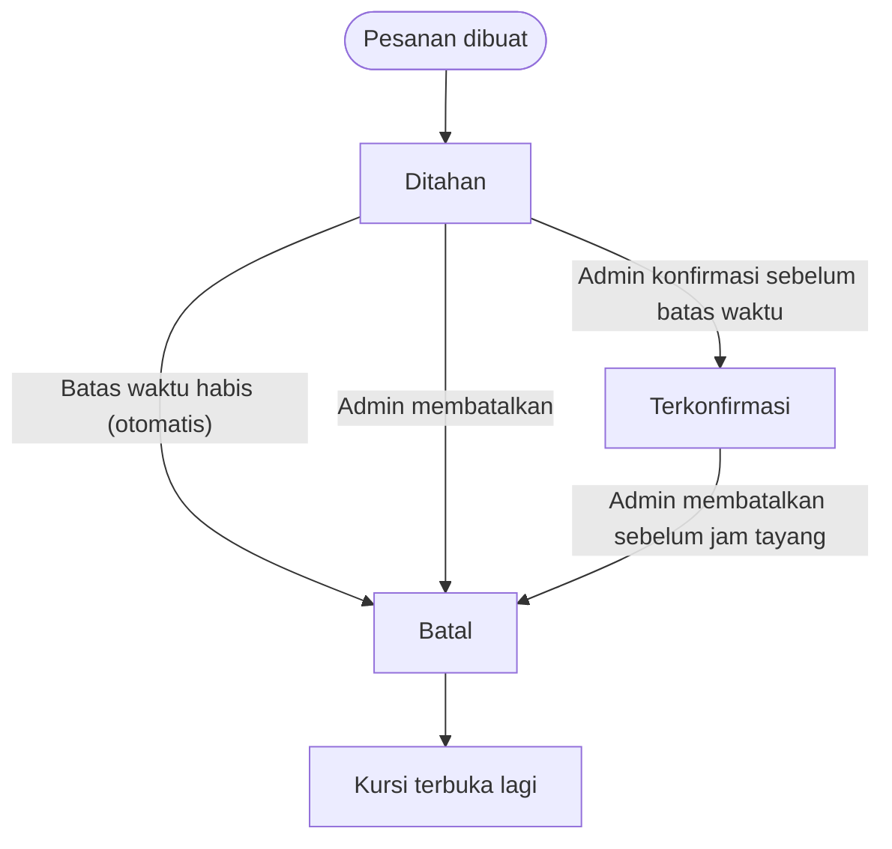
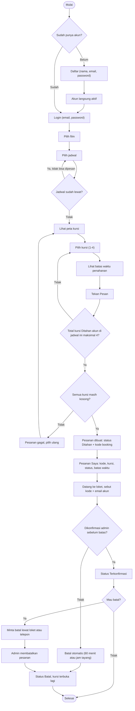
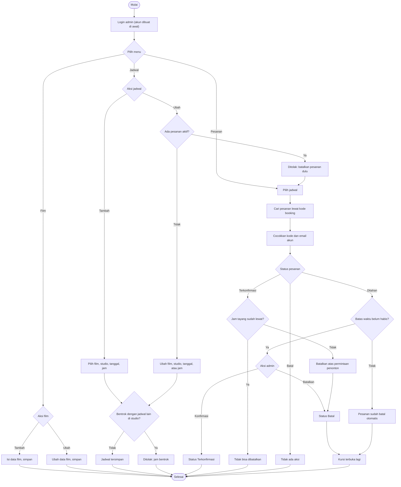
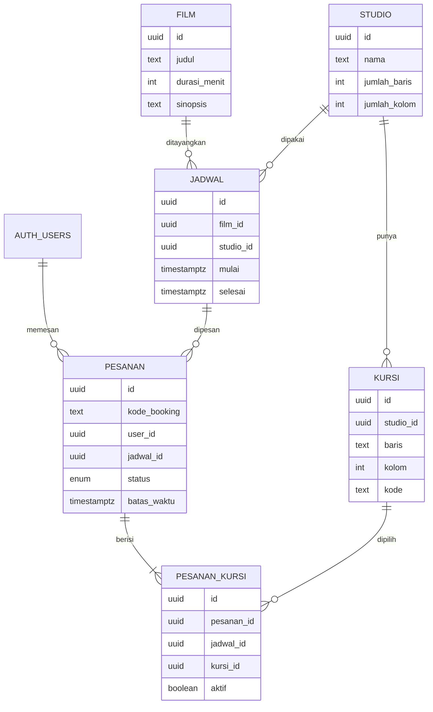

# SceneKita: Brief MVP v1

| | |
|---|---|
| **Produk** | Aplikasi web pemesanan kursi bioskop |
| **Tahap** | Project pilot (MVP v1) |
| **Waktu build** | Sekitar 4 jam |
| **Status** | Scope terkunci, semua pertanyaan terbuka sudah terjawab |
| **Tanggal** | 20 November 2026 |
| **File pendamping** | `scenekita_schema.sql` (skema database Supabase) |

---

## 1. Ringkasan

**Masalah utama:** antrean dan pemesanan manual. Penonton harus datang ke loket atau chat dulu untuk memesan kursi.

**Solusi v1:** web app untuk **satu bioskop**. Penonton login, memilih film, jadwal, dan kursi (maks 4), lalu pesanan ditahan **60 menit**. Pembayaran dan konfirmasi dilakukan di loket oleh admin. Tidak ada pembayaran online.

**Status pesanan:** `Ditahan`, `Terkonfirmasi`, `Batal`.

**Teknologi yang sudah diputuskan:** Supabase (Auth + PostgreSQL). Tidak ada tabel users sendiri. Nama penonton disimpan di metadata Auth, peran admin di `app_metadata`.

### Struktur halaman

| Area | Halaman |
|---|---|
| **Penonton** | Daftar/login, daftar film + jadwal, peta kursi, Pesanan Saya |
| **Admin** | Login, kelola film, kelola jadwal, daftar pesanan per jadwal (konfirmasi dan batalkan) |

### Dianggap selesai bila

- Penonton bisa daftar/login, memilih film, jadwal, dan kursi (maks 4), lalu mendapat pesanan dengan kode booking.
- Admin bisa tambah/ubah film dan jadwal, melihat pesanan per jadwal, serta mengonfirmasi atau membatalkan pesanan.
- Kursi yang sudah dipesan tidak bisa dipesan orang lain, termasuk saat dua orang menekan Pesan bersamaan.
- Pesanan yang melewati batas waktu otomatis batal dan kursinya terbuka lagi.
- Ada data contoh dan tampilan nyaman dibuka di HP maupun laptop.

> **Jika waktu mepet:** poin aturan kursi dan pembatalan otomatis tidak boleh dikurangi. Tampilan HP-friendly adalah yang pertama dipangkas.

---

## 2. Pengguna dan Peran

| Peran | Akun | Bisa apa |
|---|---|---|
| **Penonton** | Daftar sendiri dengan email. Langsung aktif, tanpa verifikasi email. | Lihat film dan jadwal, pilih kursi, buat pesanan, lihat pesanan sendiri |
| **Admin bioskop** | Dibuat di awal oleh pemilik sistem | Tambah/ubah film dan jadwal, lihat pesanan per jadwal, konfirmasi dan batalkan pesanan |

---

## 3. Fitur Wajib

| Kode | Fitur | Keterangan |
|---|---|---|
| **F1** | Akun dan login | Penonton daftar dan login memakai email. Admin login. Tanpa verifikasi email dan tanpa lupa password. |
| **F2** | Daftar film dan jadwal | Penonton melihat film dan jam tayangnya. |
| **F3** | Peta kursi per jadwal | Status tiap kursi terlihat (kosong atau terisi). |
| **F4** | Buat pesanan | Pilih 1-4 kursi. Status Ditahan, kode booking dibuat, batas waktu tampil jelas. |
| **F5** | Pesanan Saya | Penonton melihat kode, kursi, status, dan batas waktu pesanannya. |
| **F6** | Admin | Tambah/ubah film dan jadwal, lihat pesanan per jadwal, konfirmasi dan batalkan pesanan. |

---

## 4. Aturan Bisnis

| Kode | Aturan |
|---|---|
| **R1** | Satu kursi pada satu jadwal tidak boleh dipegang oleh dua pesanan aktif. Pengecekan dan penyimpanan harus satu langkah tak terpisah, sehingga jika dua orang menekan Pesan bersamaan hanya satu yang berhasil. |
| **R2** | Maksimal 4 kursi per pesanan. Satu akun boleh punya beberapa pesanan di jadwal yang sama, tetapi total kursi berstatus Ditahan per akun per jadwal maksimal 4. |
| **R3** | Memesan wajib login. |
| **R4** | Pesanan ditahan sampai waktu yang lebih awal antara **60 menit sejak dibuat** dan **jam tayang dimulai**. Jika belum dikonfirmasi admin, pesanan otomatis batal dan kursi terbuka lagi. |
| **R5** | Pembayaran dilakukan di loket. Aplikasi tidak menampilkan harga atau total bayar. |
| **R6** | Hanya admin yang boleh mengelola film dan jadwal, serta mengonfirmasi atau membatalkan pesanan. |
| **R7** | Studio dan layout kursi bersifat tetap (diisi di awal). Tiap jadwal terhubung ke satu studio. |
| **R8** | Jadwal yang sudah lewat tidak bisa dipesan. |
| **R9** | Penonton tidak bisa membatalkan pesanan sendiri di aplikasi. Pengajuan dilakukan lewat loket atau telepon, lalu admin yang membatalkan. |
| **R10** | Jadwal yang masih punya pesanan aktif tidak boleh diubah. Tidak ada hapus jadwal di v1. Jadwal yang salah diperbaiki dengan membatalkan pesanannya dulu, lalu mengubahnya. |
| **R11** | Setiap pesanan punya kode booking pendek yang unik dan acak (tidak berurutan). |
| **R12** | Konfirmasi hanya berlaku untuk status Ditahan yang belum lewat batas waktu. Daftar pesanan admin menampilkan sisa waktu. Pesanan yang sudah batal tidak bisa dikonfirmasi. |
| **R13** | Pesanan Terkonfirmasi hanya bisa dibatalkan sebelum jam tayang. Setelah itu statusnya terkunci sebagai riwayat. |
| **R14** | Konfirmasi dan pembatalan di loket diproses hanya jika penonton menyebut **kode booking dan email akun**. |
| **R15** | Jadwal di studio yang sama tidak boleh tumpang tindih (memakai durasi film). |
| **R16** | Batas waktu penahanan ditampilkan dengan jelas sebelum penonton menekan Pesan. |

---

## 5. Status Pesanan

| Dari | Ke | Pemicu |
|---|---|---|
| Ditahan | Terkonfirmasi | Admin menekan Konfirmasi sebelum batas waktu (R12) |
| Ditahan | Batal | Otomatis saat batas waktu habis (R4), atau admin membatalkan |
| Terkonfirmasi | Batal | Admin membatalkan atas permintaan penonton, sebelum jam tayang (R13) |
| Batal | (final) | Tidak ada perubahan lagi |

Kursi otomatis terbuka lagi begitu pesanan berstatus Batal.

---

## 6. Diagram Alur Penonton

---

## 7. Diagram Alur Admin

---

## 8. Struktur Data

Skema lengkap ada di `scenekita_schema.sql`. Tidak ada tabel users sendiri; relasi pesanan memakai `auth.users` dari Supabase Auth.

### Fitur ke fungsi database

| Fitur | Operasi |
|---|---|
| F1 Akun dan login | Supabase Auth (email + password) |
| F2 Daftar film dan jadwal | Baca tabel `film` dan `jadwal` |
| F3 Peta kursi | Fungsi `peta_kursi(jadwal_id)` |
| F4 Buat pesanan | Fungsi `buat_pesanan(jadwal_id, kursi_ids)` |
| F5 Pesanan Saya | Baca tabel `pesanan` dan `pesanan_kursi` milik sendiri |
| F6 Admin | Insert/update `film` dan `jadwal`; fungsi `pesanan_admin`, `konfirmasi_pesanan`, `batalkan_pesanan` |
| Batal otomatis (R4) | Fungsi `lepas_pesanan_kedaluwarsa()`, opsional dijadwalkan tiap menit lewat `pg_cron` |

### Data contoh

- **Studio 1:** 8 baris (A-H) × 10 kolom = 80 kursi
- **Studio 2:** 6 baris (A-F) × 8 kolom = 48 kursi
- 4 film, sekitar 3 jadwal per studio per hari untuk 3 hari ke depan

### Langkah setelah menjalankan skema

1. Buat akun admin di Supabase Authentication, lalu tandai perannya lewat perintah `update auth.users ...` (ada di akhir file SQL). Admin perlu login ulang.
2. Reset password penonton dilakukan manual di luar aplikasi (Authentication > Users).
3. Opsional: aktifkan `pg_cron` agar pesanan kedaluwarsa dibatalkan tiap menit. Tanpa cron, aturan tetap aman karena pengecekan kedaluwarsa dilakukan saat memesan, mengonfirmasi, dan menampilkan peta kursi.

---

## 9. Di Luar Cakupan (Tidak Dibuat di v1)

- Pembayaran online, harga tiket, dan total bayar
- Admin mengelola studio dan layout kursi
- Notifikasi email/WA dan info/pengumuman ke penonton
- E-tiket / QR code
- Voucher dan promo
- Laporan dan statistik
- Multi-bioskop
- Verifikasi email dan fitur lupa password (reset dilakukan manual)
- Pengajuan pembatalan di dalam aplikasi oleh penonton
- Admin mengubah kursi pesanan
- Mengubah atau menghapus jadwal yang sudah punya pesanan aktif
- Hapus jadwal (tidak ada sama sekali di v1)

---

## 10. Risiko yang Diterima untuk Pilot

- **Akun palsu:** karena tidak ada verifikasi email, satu orang bisa membuat banyak akun untuk menyiasati batas 4 kursi (R2). Dampaknya dibatasi karena konfirmasi tetap dilakukan di loket dengan kode booking dan email akun (R14).
- **Pembatalan otomatis tanpa cron:** pesanan yang kedaluwarsa bisa tampil Ditahan sampai ada aktivitas berikutnya di jadwal itu. Kursinya tetap diperlakukan terbuka, dan konfirmasinya ditolak (R12).

---

## 11. Pertanyaan Terbuka

Tidak ada. Semua pertanyaan dari wawancara dan tinjauan celah alur sudah terjawab dan masuk ke dokumen ini.
